# Sage on the desk

Sage is the robot that lives on [destbreso.com](https://destbreso.com). This project gives it a body on my desk: a small glass prism display, where black turns to glass, so its cream shell and green eyes seem to float. It keeps me company while I work and reacts to what happens on my computer: Claude Code thinking or waiting for me, tests passing or failing, a push.

What is here:

- **Sage itself** (`design/`): drawn as code, illustrated and shaded, with the same face and mind it has on destbreso.com. Its moods, the transitions between them and its acts can all be played in a browser (`design/sage.html`). Sage is mine and not open source: see [LICENSE-ART.md](LICENSE-ART.md).
- **The firmware** for the Waveshare ESP32-S3-LCD-1.3 prism (240 by 240 pixels, with a motion sensor that feels a tap). It renders each frame from drawing instructions, about a kilobyte or a few a frame, so a lot of animation fits, and it takes new clips over Wi-Fi without being flashed again.
- **The bridge** on the Mac (`tools/buddy_bridge.py`), which hears Claude Code's hooks and what the terminal runs, picks how Sage should react, and tells the board over USB or Wi-Fi.
- **The emulator** (`emulator/`), a web page that plays the frames exactly as the board does and plugs into the bridge as if it were the board, so everything can be built and tried before the hardware is on the desk.
- **The tools** that bake drawings into frames, check each frame against the browser's own drawing (`tools/vec_check.cpp`), update the board over the air, and print the enclosure.

## Gallery

Sage as the board will show it, each animation played through the same bake that writes its frames for the board (`tools/export_frames.py --gif`). On the prism the black around it is glass, so it seems to float. Everything in its world is made for it, never a stock picture: what comes in for what is happening is the site's own (its prompt, the Game of Life's glider, the rain) or Sage's own (its modules, the room's phone), and the camera moves round it in a small 3D world.

### Every day

<table>
<tr><td align="center">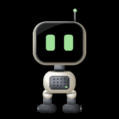 Turning round on the spot</td><td align="center">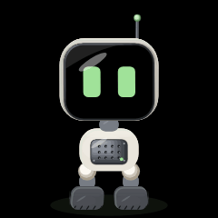 Waiting for something to happen</td><td align="center">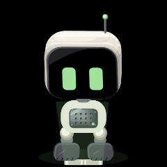 Reading while Claude works</td><td align="center">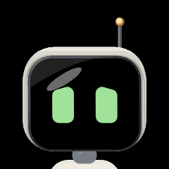 Something needs you</td></tr>
<tr><td align="center">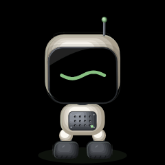 Asleep at night</td><td align="center">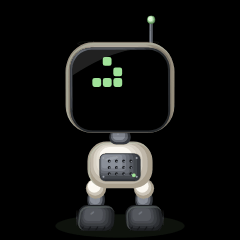 A long job done: a glider crosses its visor</td><td align="center">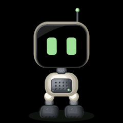 The site's prompt on its face</td><td align="center">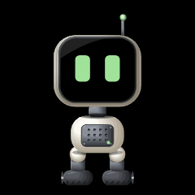 A look over its shoulder</td></tr>
</table>

### What I am doing

<table>
<tr><td align="center">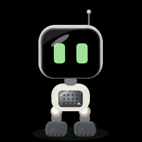 Tests fail: a glitch scuttles in, and it stomps it</td><td align="center">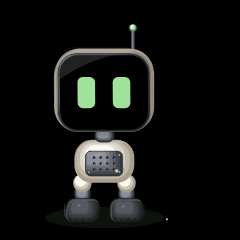 A deploy: the site's prompt takes off</td><td align="center"> A build: its own modules land on the pile</td></tr>
</table>

### The camera

<table>
<tr><td align="center">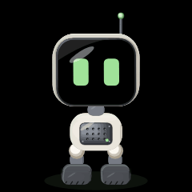 All the way round it</td><td align="center">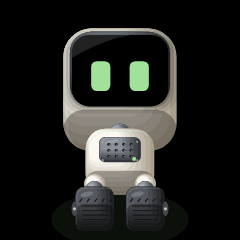 From below to above</td><td align="center">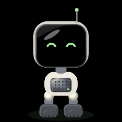 From straight above</td></tr>
</table>

### Made of the rain

<table>
<tr><td align="center">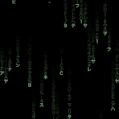 Forming out of the rain, eyes first</td><td align="center">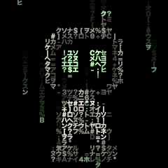 Made of glyphs</td></tr>
</table>

## Roadmap

- [x] The engine from Joe Bentham's desk-buddy and Chris Simpkins's fork, with none of their character's art
- [x] A web emulator of the board, connected to the real bridge
- [ ] Sage drawn as code, illustrated, with its glyph moments from the rain of destbreso.com, and baked for the prism
- [ ] Sage's mind in the bridge: reactions that never repeat, its patience, its battery, its voice
- [ ] My workflow as Sage's senses: sessions, tests, builds, renders, pushes and deploys
- [ ] A gallery of every animation, with what triggers it
- [ ] The board: flashed, measured, and in an enclosure shaped like Sage

The phases and what each one involves are in [docs/ROADMAP.md](docs/ROADMAP.md); what is done, and how it was checked, is in [docs/HISTORY.md](docs/HISTORY.md).

## Credits

This started as [desk-buddy](https://github.com/joebentham/desk-buddy) by Joe Bentham, a companion called Lump on the same display: the firmware, the bridge, the bake and the enclosure are his. Chris Simpkins's [fork](https://github.com/csimpkins22/desk-buddy) added frames as drawing instructions rendered on the board, clips over Wi-Fi, and reactions to what the terminal runs. Both are MIT, and so is everything here except Sage: see [LICENSE](LICENSE).
